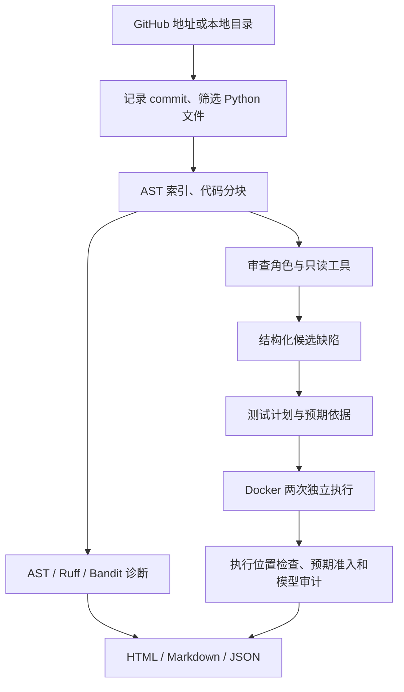

# 当前框架与实际运行方式

本项目用 Python 主程序调度 HelloAgents 角色，通过现有 OpenAI 兼容接口调用 DeepSeek。角色顺序执行：代码审查、候选复核或测试生成、运行证据审计。当前没有训练模型权重，也没有自动提交修复的流程。

调度程序固定各阶段及预算；模型在阶段内选择读取哪些代码、提出什么候选、怎样构造测试。会话状态保存在本次工具消息中，跨运行追溯依靠独立报告和证据文件。开发者使用的共享知识库属于开发工作流，未自动注入被测审查 Agent。

## 产品执行链

入口是 `main.py`，主调度在 `src/pipeline.py`。`src/repository.py` 获取仓库、记录固定 commit、筛选文件并计算内容摘要。文件数量、大小和调用预算都会限制覆盖范围；完成选定窗口不等于读完仓库。

`src/code_index.py` 用 AST 提取函数、类和导入，按真实行号切块。默认每块最多180行或20000字符。三个工具供模型补充上下文：`read_code` 读取已索引代码（最多120行），`search_symbol` 查定义，`search_code` 做字面检索。每次角色运行最多两轮读取，每轮最多四个工具调用，最后收尾为 JSON。当前使用文本工具协议，并在收尾请求 JSON 对象。

`src/static_analysis.py` 在代码快照上运行 AST、Ruff 和 Bandit。静态诊断单独保留；这些诊断本身不构成真实运行证明。默认 evidence 的候选输入以行为代码及上下文为主，未把所有静态告警直接当作已确认缺陷。

`src/agents.py` 包含模型客户端和角色提示。`ReviewAgents` 每次建立独立的角色对话，避免沿用之前候选的会话历史。审查返回文件、行号、问题、触发条件、依据与建议，经 JSON/Pydantic 和位置检查后形成候选。`full` 模式另用复核角色寻找反例；`evidence` 则进入测试计划和证据审计。

`legacy` 上下文沿用原有函数/名称检索；实验选项 `callgraph` 在 `src/review_context.py` 中解析可确定的静态调用、导入和作用域，优先补充所在函数、调用者、被调用定义及相关文档。它不覆盖所有动态调用，补充内容含元数据限制为10000字符。未验证发现率收益，因此默认仍为 legacy。

## 复现证据链

`src/reproduction.py` 要求测试计划给出具体输入、预期结果及可定位的预期依据，测试必须调用仓库原函数。当前计划还包含预期类型、前置条件和未证实假设；只有异常文案差异不进入正式行为缺陷。

Docker 执行使用源码只读、无外网、普通用户和资源上限。两次全新容器运行同一个测试，程序记录目标文件的实际执行行和异常帧，区分导入失败、未调用目标、无关失败、测试通过及候选对应的失败。重复失败后，再检查预期准入、输入有效性和模型对照原文的审计结果。通过者标为 `reproduced`，其余保留在待验证候选中。该标签仍需要维护者复查，不能由“两次 AssertionError”直接推出缺陷成立。

一次执行反馈修正是可选实验项，默认0次。允许修正测试构造时，原预期依据和 expected_behavior 必须保持不变，所有原始失败记录保留。

报告由 `src/report.py` 生成：`report.html` 用于浏览器筛选，`report.md` 用于阅读，`report.json` 保存候选、轨迹和消耗，`run.json` 记录版本、覆盖和失败；证据目录保留测试与执行日志。

## 模式与预算

| 模式 | 实际流程 |
|---|---|
| static | AST、Ruff、Bandit，不调用模型 |
| direct | 原代码窗口直接调用模型 |
| assisted | 静态线索、索引上下文和只读工具辅助审查 |
| full | assisted 后逐批复核候选 |
| evidence（默认） | 行为候选、测试计划、隔离执行、预期准入及证据审计 |

模型通过 `.env` 的 LLM_MODEL_ID、LLM_BASE_URL、LLM_API_KEY 配置。当前实验实际使用 deepseek-flash。SDK 自动重试关闭；普通 CLI 用 `--max-calls` 限制本次审查，包括复核、计划与审计请求。模型格式纠正也消耗调用。

本次600次全局硬上限由 `evaluation/discovery_experiment.py` 的 `AttemptBudget` 和 `RecordedLLM` 实现：每次请求先加锁扣减并持久化，再调用服务；失败和重试不退款，记录请求、返回结果或失败。普通 CLI 的每次运行预算与该实验全局账本是两个层级。

## 本次测评怎样运行

开发对照使用预先选定的6个历史漏检样本、两个版本、两次重复；按原窗口逐项交替执行两组。三轮依次只变上下文、thinking 开关、输出上限。只跑候选发现，不启动 Agent 的测试生成和证据审计，因此本次候选成绩不能替代历史有效生成证据成绩。

Agent 得到生产代码窗口和同版本索引；官方测试、补丁、参考问题和相反版本由评测侧持有。窗口位置由参考补丁确定，所以这是已知位置识别测试。官方回归测试独立在容器中验证缺陷版失败、修复版通过；随后对照冻结的参考问题判读候选，调用原评分函数。失败窗口和未完成缺陷对显式保留，额外候选独立核验。

发现与证据的主要限制：模型可能误判预期、遗漏跨窗口关系，文本工具/JSON协议可能失败，生成测试受依赖和环境限制。单一额外发现、候选数或静态告警数都不足以证明整体发现率提升。实际结论以 `demo/discovery-context-20261015/README.md` 及冻结原始记录为准。
